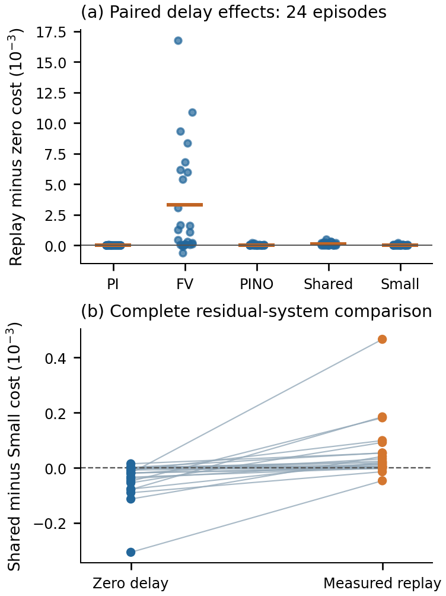

# Thermal Delay Evaluation

**Reproducible data and analysis for evaluating thermal controllers under measured inference delay.**

This study follows the chain from candidate-action scores and measured inference time to applied heater commands and closed-loop outcomes. It also checks whether the main comparisons persist when the simulated plant's integration step is reduced.

The repository accompanies **Inference-Delay-Aware Evaluation of Learning-Based Thermal Controllers: A Retrospective Simulation Study**, by **Minsu Jo, Namhyun Yoo, Hoansuk Choi, and Jinhong Yang**. The English manuscript is in preparation for J-KICS. Version 1.0.0 corresponds to the evidence package prepared on 8 October 2026.

[Quick start](#quick-start) · [Results](#what-the-records-show) · [Data download](#download-and-audit-the-detailed-records) · [Data dictionary](docs/DATA_DICTIONARY.md) · [Reproduction scope](docs/REPRODUCTION.md) · [Citation](#citation)

## What the records show

The primary comparison uses **24 normal test episodes** and five implemented control pipelines: PI, finite-volume MPC (FV-MPC), physics-informed neural-operator MPC (PINO-MPC), Shared-Residual, and Small-Residual. Each is evaluated with zero delay and its own archived, measured latency replay.

| Finding | Evidence | Interpretation |
|---|---|---|
| Including measured delay changes the controller ranking. | FV-MPC moves from the lowest zero-delay mean cost to the highest replay mean cost, increasing by **25.02%**. Each FV replay episode has eight deadline fallbacks and eight skipped ticks. | Application timing and the resulting command sequence are part of the comparison. |
| The principal mean comparisons persist under plant-step refinement. | D's mean ranking is unchanged at maximum steps of **10, 5, and 2.5 ms** within each execution mode. | The tested aggregate comparisons are stable over these caps. |
| Individual trajectories remain sensitive. | One Shared-Residual replay episode changes by **3.892%** from 5 to 2.5 ms; all 24 Shared replay episodes change at least one requested command. | Stable averages do not establish trajectory convergence. |
| Fixed-command replay and recomputed feedback have different sensitivities. | In one selected C episode, fixed-command costs change by less than **0.0032%** from 10 to 1.25 ms, while the lowest-cost closed-loop delay changes with the cap. | The selected delay result remains a bounded sensitivity diagnostic. |

<p align="center">
  
</p>

*Paired results for the 24 normal test episodes. Each point or connected pair represents an episode. The intervals and comparisons condition on the selected models and reused timing records.*

The contribution is a reproducible evaluation procedure and its application to these preserved systems. The data do not establish general controller superiority, an optimal physical delay, or a universally better checkpoint selector.

## Quick start

Use **Python 3.10–3.12**. The analysis was tested with Python 3.12.7, NumPy 1.26.4, and Matplotlib 3.9.2. These commands use the CPU and saved records; they require no model download or GPU.

```bash
git clone https://github.com/JoMinsu-KU/thermal-delay-evaluation.git
cd thermal-delay-evaluation
python -m pip install -r requirements.txt
python scripts/verify.py
python scripts/reproduce.py
```

Use a Python virtual environment if your current environment contains unrelated project dependencies. See [REPRODUCTION.md](docs/REPRODUCTION.md) for the computation and numerical scope.

### Generated outputs

| Output under `outputs/` | Contents |
|---|---|
| `table6_primary_costs.csv` | Mean costs and paired replay effects for all five methods |
| `table7_paired_comparisons.csv` | Shared–Small and Shared–PINO comparisons in each execution mode |
| `table8_numerical_sensitivity.csv` | Principal comparisons across the three actual-plant step caps |
| `all_numerical_contrasts.csv` | All 27 numerical contrasts, including paired bootstrap intervals |
| `development_comparisons.json` | A/B development comparisons, kept separate from test evidence |
| `figures/` | Regenerated versions of all four manuscript figures |
| `reproduction_checks.json` | Numeric agreement checks and the analysis scope |

The script also exports the 60 preserved pooled/repeat latency summaries. Independent latency and field-difference reconstruction uses the detailed records below. Bootstrap intervals use **20,000 paired episode resamples**, seed **20261007**. Percentage changes in mean cost are ratios of means, which differ from averages of individual percentage changes.

## Download and audit the detailed records

The small results and analysis code are tracked in Git. Detailed event logs and temperature arrays are distributed as assets of [Release v1.0.0](https://github.com/JoMinsu-KU/thermal-delay-evaluation/releases/tag/v1.0.0).

| Release asset | Size | Contents |
|---|---:|---|
| [Primary experiment records](https://github.com/JoMinsu-KU/thermal-delay-evaluation/releases/download/v1.0.0/thermal-delay-primary-raw-v1.zip) | 113 MiB | Original D metrics/events, 180,000 latency request records, and original selected C traces |
| [Numerical validation records](https://github.com/JoMinsu-KU/thermal-delay-evaluation/releases/download/v1.0.0/thermal-delay-numerical-raw-v1.zip) | 263 MiB | All 741 validation runs, with quadrature for the 732-run extended batch and fixed-command C fields |
| [SHA256SUMS](https://github.com/JoMinsu-KU/thermal-delay-evaluation/releases/download/v1.0.0/SHA256SUMS) | <1 KiB | SHA256 checksums for the two ZIP files |

Download links become available when the maintainer publishes that release. Both ZIPs expand into the Git-ignored `raw_data/` directory. Allow approximately **1 GiB** for the expanded records in addition to the ZIP files.

With [GitHub CLI](https://cli.github.com/):

```bash
gh release download v1.0.0 --repo JoMinsu-KU/thermal-delay-evaluation --pattern "thermal-delay-*-raw-v1.zip" --pattern "SHA256SUMS"
```

<details>
<summary>Linux/macOS: verify, extract, and audit</summary>

```bash
# Linux; on macOS use: shasum -a 256 -c SHA256SUMS
sha256sum -c SHA256SUMS
unzip thermal-delay-primary-raw-v1.zip
unzip thermal-delay-numerical-raw-v1.zip
python scripts/verify.py --raw-dir raw_data
python scripts/audit_raw.py --raw-dir raw_data
```

</details>

<details>
<summary>Windows PowerShell: verify, extract, and audit</summary>

```powershell
Get-Content -LiteralPath SHA256SUMS | ForEach-Object {
    $hash, $name = $_ -split '  ', 2
    if ((Get-FileHash -LiteralPath $name -Algorithm SHA256).Hash.ToLowerInvariant() -ne $hash) {
        throw "Checksum mismatch: $name"
    }
}
Expand-Archive -LiteralPath thermal-delay-primary-raw-v1.zip -DestinationPath .
Expand-Archive -LiteralPath thermal-delay-numerical-raw-v1.zip -DestinationPath .
python scripts/verify.py --raw-dir raw_data
python scripts/audit_raw.py --raw-dir raw_data
```

</details>

The raw audit writes to `outputs/raw_audit/`. It checks **732 independent quadrature cost reconstructions**, **243 baseline comparisons**, **12 fixed-field comparisons**, **720 D episode/step trace comparisons**, **180,000 journal row hashes**, and **71,808 replay-request mappings**. For the earlier nine C runs, tracking quadrature was not saved; their cost checks use reported tracking RMSE with independently reconstructed command terms and final fields.

Here, “independent reconstruction” describes recalculation from the saved records. It does not mean independently sampled runs or a new experiment.

## Data populations and experimental units

| Evidence group | Released coverage | Independent units and scope |
|---|---|---|
| A — checkpoint development | Two checkpoints, eight paired validation episodes | Same episodes; training schedules also differ |
| B — checkpoint selection | 15 candidates, 600 candidate trajectories, 80 reference trajectories | Eight reused validation episodes, including six normal episodes; five synthetic delay settings |
| C — selected delay case | Three original delay conditions, nine closed-loop recomputations, 12 fixed-command replays | **One selected episode**, using an earlier direct scorer |
| D — original evaluation | Five methods × two modes × 48 archived test/OOD episodes = 480 result records | Main comparison: **24 normal test episodes**; eight initially hot and 16 OOD episodes retained separately |
| D — plant-step validation | Five methods × two modes × 24 normal episodes × three caps = 720 runs | The same **24 normal episodes** at each cap |
| Latency measurements | 180,000 requests across three process repeats | Reused inputs and timing sequences |

The two numerical batches contain **741 executions = 9 + 12 + 720**. The extended batch alone contains **732 = 12 + 720**. The execution count does not enlarge the independent sample to 741 episodes. C and D use different controller versions. Within D, the source identifiers `shared_physics` and `small_physics` denote Shared-Residual and Small-Residual.

## Numerical scope and reproduction limits

Only the actual plant's maximum inner finite-volume step was refined. The 64 × 64 FP64 grid, controller prediction settings, selected checkpoints, calibration, sensor schedule, and archived latency matching rule were retained. Cost quadrature and peak sampling remain at the original 10-ms/event endpoints.

The checks cover the tested mean comparisons and expose individual sensitivities. They do not establish spatial convergence, finer predictor accuracy, continuous-time peak bounds, or uncertainty across retrained models and new latency samples. The new numerical runs exclude initially hot and OOD episodes.

`experiment_source/` preserves the relevant C/D implementations and validation harnesses for inspection. Fresh training or inference additionally requires the original model weights, generated inputs, caches, calibration data, and Linux/H200 environment. This release provides **saved-result reanalysis and implementation provenance**; the complete training snapshot is separate.

## Repository layout

```text
data/
  primary/              Original test/OOD summaries and timing evidence
  development/          A/B checkpoint-development and selection records
  selected_C/           Applied commands and first-divergence evidence
  numerical/            741-case index, metrics, and refinement comparisons
  protocol/             Preserved evaluation and validation settings
scripts/                Portable verification, statistics, and plotting
figures/                Four figures used in the manuscript
experiment_source/      Preserved C/D implementation and validation harnesses
checks/                 Recorded package and analysis checks
docs/                   Data dictionary, provenance, and reproduction scope
CITATION.cff            Dataset citation metadata
MANIFEST.sha256         Repository file checksums
```

Useful documentation: [Data dictionary](docs/DATA_DICTIONARY.md), [reproduction scope](docs/REPRODUCTION.md), [provenance](docs/PROVENANCE.md), and [release notes](docs/RELEASE_NOTES.md). For reproducible comparisons, retain the repository version and the raw-asset checksums together.

## Citation

Please cite the data release and identify the version used. The repository's **Cite this repository** entry is generated from [CITATION.cff](CITATION.cff).

```bibtex
@misc{jo2026thermaldelaydata,
  author = {Jo, Minsu and Yoo, Namhyun and Choi, Hoansuk and Yang, Jinhong},
  title = {Data and Analysis for Inference-Delay-Aware Evaluation of
           Learning-Based Thermal Controllers: A Retrospective Simulation Study},
  year = {2026},
  version = {1.0.0},
  url = {https://github.com/JoMinsu-KU/thermal-delay-evaluation},
  note = {Research data and analysis code; associated manuscript in preparation}
}
```

No manuscript DOI has been assigned in this package. Metadata can be updated when publication details are available.

## License

- **Code and its documentation:** [MIT](LICENSE).
- **Data and research figures:** [CC BY 4.0](DATA_LICENSE), with the [full legal text](LICENSES/CC-BY-4.0.txt) included. Attribute the authors and version, retain the license notice, and indicate changes.

External dependencies retain their own licenses. Model weights, third-party papers, journal templates, and fonts are not redistributed here.

For a data inconsistency or reproduction issue, open an [issue](https://github.com/JoMinsu-KU/thermal-delay-evaluation/issues) with the version, command, and relevant output; omit credentials and private machine details.
