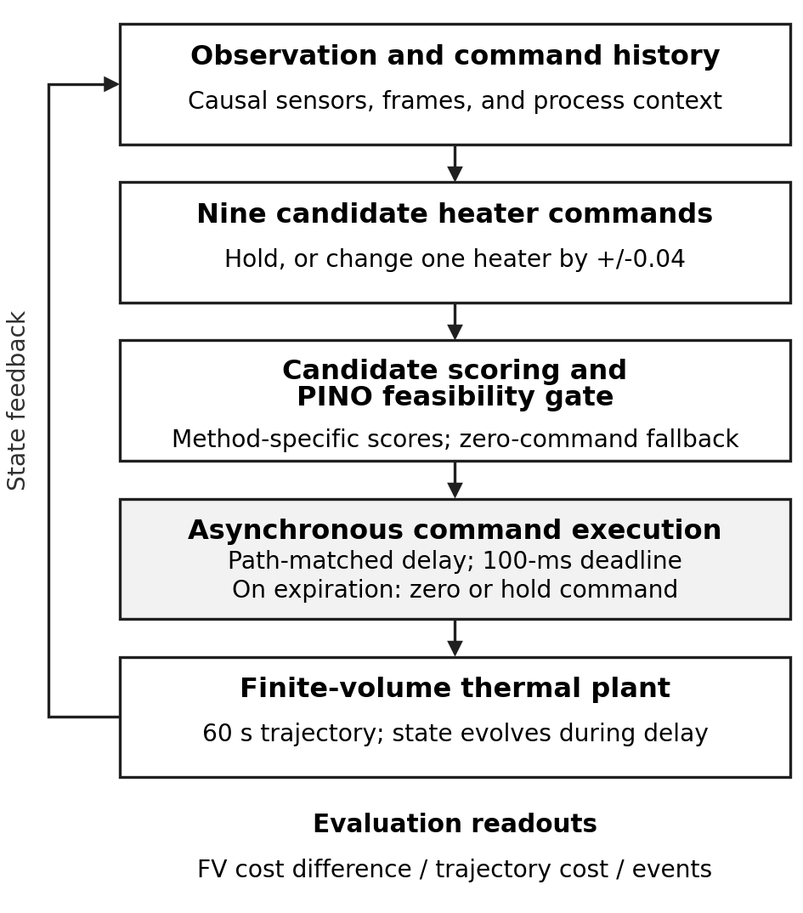
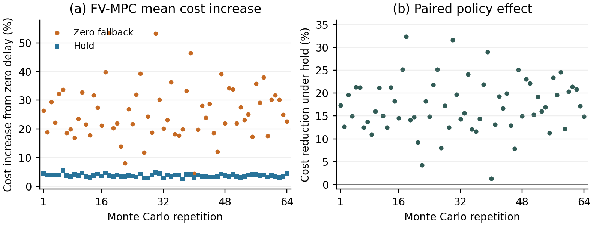
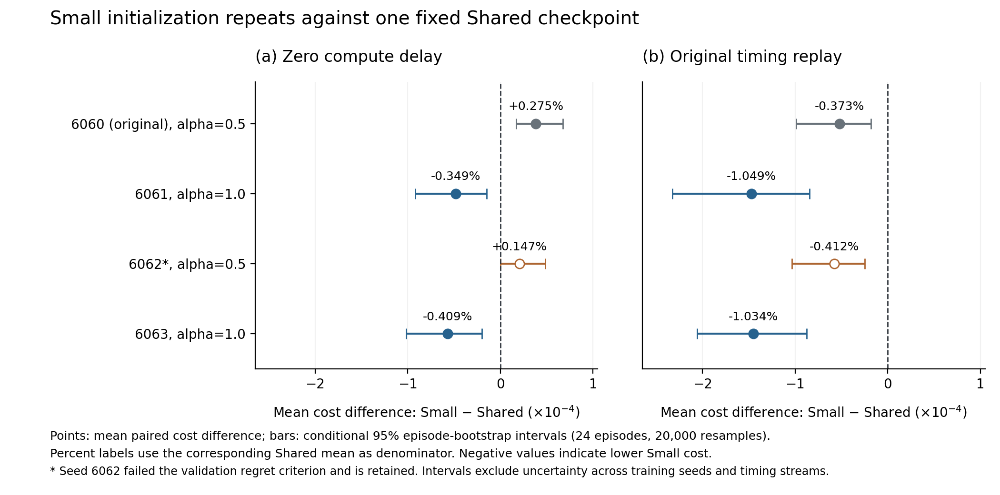

# Thermal Delay Evaluation

**Reproducible data analysis of inference delay, deadline commands, and simulated thermal control.**

Companion to *Inference Delay and Deadline Handling in Thermal Controller Evaluation*, by **Minsu Jo, Namhyun Yoo, Hoansuk Choi, and Jinhong Yang**. The English manuscript is being prepared for J-KICS; no acceptance is claimed. **Version 1.3.4** adds independently executable evidence for all 1,536 FV Monte Carlo schedule pairs, fixes a Linux JSON line-ending comparison, and clarifies the command library and recovery definition. Existing experimental results are unchanged.

[Quick start](#quick-start) · [Monte Carlo results](#monte-carlo-results) · [Evidence map](supplement/TABLE_FIGURE_MAP.md) · [S1 guide](docs/Supplement_S1_guide.pdf) · [Reproduction scope](docs/REPRODUCTION.md)

## Research question

How do inference completion times and deadline commands change a controller comparison when ordinary commands are selected from a restricted candidate set? Five frozen implementations—PI, FV-MPC, PINO-MPC, Shared-Residual and Small-Residual—control the same simulated four-heater plate. Requests have a 100-ms deadline. Each ordinary candidate changes at most one heater by at most 0.04. This shared discrete search library is an evaluation-design choice, not a physical actuator slew-rate limit. A forced zero command therefore changes the starting point for subsequent command recovery.

The study uses **24 nominal held-out episodes**. Repeated timing settings and model initializations reuse these episodes. Lower whole-episode cost is the ranking criterion; it does not establish lower temperature peaks, stability or deployment safety.



Figure 1 is also provided as vector PDF/SVG. Regenerate it with `python -B supplement/scripts/make_evaluation_flow.py --output supplement/outputs/figures`.

## Monte Carlo results

The completed batch contains **240 baseline reproductions + 9,216 new runs**. Each of 64 repetitions uses independently sampled delays for five methods with zero fallback and an additional paired FV hold condition. Draws use replacement from archived method/path/token-matched H200 timing pools. The count and sampler were fixed before execution; every result is retained.

| Condition | Mean cost increase from its zero-delay baseline | Empirical 2.5th–97.5th percentile |
|---|---:|---:|
| PI / zero | 0.320% | 0.090–2.757% |
| FV-MPC / zero | **26.012%** | **10.185–49.400%** |
| PINO-MPC / zero | 0.436% | 0.223–3.141% |
| Shared / zero | 0.878% | 0.739–0.911% |
| Small / zero | 0.250% | 0.230–0.281% |
| FV-MPC / hold | **3.722%** | **2.842–4.712%** |

These percentiles describe the spread of 64 simulated repetition means; they are **not confidence intervals for a mean**. Each repetition averages the same 24 episodes.



| Repetition-level event | Count | Wilson 95% interval |
|---|---:|---:|
| FV has strictly highest cost with zero | 61/64 | 87.10–98.39% |
| FV ranks first with hold | 64/64 | 94.34–100% |
| FV hold has lower mean cost than FV zero | 64/64 | 94.34–100% |
| Original Small has lower mean cost than Shared | 64/64 | 94.34–100% |

FV hold is compared against the other four methods retaining zero fallback. All 1,536 FV trajectory pairs share potential draws and, independently verified from the included actual logs, realized request/deadline schedules. At the episode level, hold wins 1,034 pairs, ties 114 and loses 388, using the protocol's absolute 1e-10 cost tolerance. Its favorable aggregate result is not uniform across trajectories.

**Scope:** frequencies and intervals condition on the fixed checkpoints, 24 episodes, empirical timing pools and IID sampling. IID sampling removes serial timing correlation. Finite-pool uncertainty, new hardware, new episodes and retraining are not included. The original Small checkpoint is used; the three additional Small seeds are not crossed with these 64 timing repetitions. The 9,216 runs are not 9,216 independent physical scenarios.

## Independently check the FV schedule claim

```bash
python -B supplement/scripts/reproduce_monte_carlo_schedule.py
```

The full reproduction command also runs this standard-library check. The approximately **33-MB evidence subset** contains both policy arms of all **1,536 pairs / 3,072 cases**, **3,667,828 schedule events**, **1,824,628 consumed draw records**, the complete **36,000-row FV timing pool**, and all 20 protocol-pinned harness files. The verifier independently reimplements deterministic draws and checks request admission, completion, application, strict expiration, and busy skips in integer nanoseconds. Every pair and draw passed; each policy has 912,314 requests, 9,091 expirations and 9,286 busy skips.

The exported fields were also compared against every corresponding raw case log in the original 5.1-GB ZIP. See the [schema, provenance and commands](supplement/data/monte_carlo_schedule_audit/README.md). These are saved simulation-scheduler times computed from sampled measured latencies; the check runs no GPU inference or new control simulation. Full raw-field cost reconstruction remains a separate author audit receipt.

## Thermal interpretation

In the original replay, hold reduces whole-episode FV cost, while zero fallback yields lower late spatial-mean tracking error and overshoot (0.511 K and 2.130 K, versus 1.089 K and 4.641 K under hold). The policies therefore trade whole-episode tracking against late response; the cost ranking is tied to the stated objective.

## Earlier evidence retained

- Original fixed replay: FV mean cost increases by 25.02% under zero and 2.35% under hold.
- Seven fixed settings: increases range from 11.70–79.34% under zero and 2.19–6.46% under hold. These selected sequences have a different interpretation from Monte Carlo percentiles.
- Saved command analysis: 715 nonzero resets, 324 observed full-vector restorations and 391 censored events. A restored historical command need not remain thermally desirable.
- Plant-step checks preserve the original aggregate ordering without establishing trajectory convergence or stable effect magnitude.

## Small initialization results

Percentages below are **100×(Small mean / Shared mean−1)**. Negative values favor Small. Each row uses the same 24 nominal episodes and one fixed Shared checkpoint.

| Small initialization | Selected alpha | Zero delay | Original replay | Validation improvement |
|---|---:|---:|---:|---|
|6060 (original)|0.5|+0.275%|−0.373%|Pass|
|6061|1.0|−0.349%|−1.049%|Pass|
|6062|0.5|+0.147%|−0.412%|**Fail; retained**|
|6063|1.0|−0.409%|−1.034%|Pass|

All three new models complete 450 optimizer steps but select warmup step 50. Seed 6062's final validation FV candidate-cost difference is 6.3398e−7, above the initial 6.2609e−7; infeasible selections and unexpected fallbacks are both zero. Its alpha is chosen by the separate, prespecified closed-loop validation rule. The failed outcome is included in every relevant summary.



The new tests reuse Small's archived latency and calibration. Shared is not retrained. There are **24 unique test episodes**, not 72 independent observations per timing mode. Intervals resample matched episodes conditional on each checkpoint pair and fixed timing. The observed one-of-three reversal count is not a population probability. Architecture, pretraining and selected alpha are not isolated causal effects. The new models are evaluated only at the 10-ms plant cap.


## Quick start

Python 3.10+, NumPy and Matplotlib are sufficient. No GPU or model download is needed.

```bash
python -m pip install -r requirements.txt
python -B scripts/reproduce_all.py
```

This verifies integrity hashes and reanalyses the saved outcomes, regenerating **five main figures and six supplementary figures** under `supplement/outputs/`. For the Monte Carlo subset:

```bash
python -B supplement/scripts/reproduce_monte_carlo.py
python -B supplement/scripts/make_monte_carlo_figure.py
```

Inspect `supplement/outputs/monte_carlo/checks.json`. The script checks all 9,456 saved costs and component sums, the complete roster, 384 group means, 18 distributions, 39 rank-event probabilities and 64 paired effects. The [evidence map](supplement/TABLE_FIGURE_MAP.md) connects all eleven main tables and eleven figures to inputs and generators. Historical filenames retain earlier numbering.

## Data populations

| Evidence | Executions/records | Scope |
|---|---|---|
| Original nominal comparison | Five methods × two modes × 24 episodes | 24 nominal episodes; eight initially hot episodes are separate |
| Numerical checks | 720 D runs + 21 selected-C checks | Same D episodes; C is one post hoc selected case |
| Fixed replay / fallback | 1,128 runs, including 240 baseline reproductions | Seven fixed settings on the same episodes |
| Command / margin / response analysis | 336 FV traces; 57,504 scored residual requests; 552 curves | Dependent events and samples within episodes |
| Small initialization | 48 baseline + 144 new tests; 288 validation rollouts | Three new Small seeds; 24 reused tests; 16 separate validation episodes |
| Latency Monte Carlo | 240 baseline + 9,216 new runs | 64 independent timing repetitions conditional on the same 24 episodes and pools |

## Download and audit the detailed records

Original primary and numerical-validation event logs and temperature arrays remain available in [Release v1.0.0](https://github.com/JoMinsu-KU/thermal-delay-evaluation/releases/tag/v1.0.0).

| Release asset | Size | Contents |
|---|---:|---|
| [Primary experiment records](https://github.com/JoMinsu-KU/thermal-delay-evaluation/releases/download/v1.0.0/thermal-delay-primary-raw-v1.zip) | 113 MiB | Original D metrics/events, 180,000 latency request records, and original selected C traces |
| [Numerical validation records](https://github.com/JoMinsu-KU/thermal-delay-evaluation/releases/download/v1.0.0/thermal-delay-numerical-raw-v1.zip) | 263 MiB | All 741 validation runs, with quadrature for the 732-run extended batch and fixed-command C fields |
| [SHA256SUMS](https://github.com/JoMinsu-KU/thermal-delay-evaluation/releases/download/v1.0.0/SHA256SUMS) | <1 KiB | SHA256 checksums for the two ZIP files |

These are the unchanged v1.0.0 assets. They do not contain the later replay/hold batch. Both ZIPs expand into the Git-ignored `raw_data/` directory. Allow approximately **1 GiB** for the expanded records in addition to the ZIP files.

With [GitHub CLI](https://cli.github.com/):

```bash
gh release download v1.0.0 --repo JoMinsu-KU/thermal-delay-evaluation --pattern "thermal-delay-*-raw-v1.zip" --pattern "SHA256SUMS"
```

<details>
<summary>Linux/macOS: verify, extract, and audit</summary>

```bash
# Linux; on macOS use: shasum -a 256 -c SHA256SUMS
sha256sum -c SHA256SUMS
unzip thermal-delay-primary-raw-v1.zip
unzip thermal-delay-numerical-raw-v1.zip
python scripts/verify.py --raw-dir raw_data
python scripts/audit_raw.py --raw-dir raw_data
```

</details>

<details>
<summary>Windows PowerShell: verify, extract, and audit</summary>

```powershell
Get-Content -LiteralPath SHA256SUMS | ForEach-Object {
    $hash, $name = $_ -split '  ', 2
    if ((Get-FileHash -LiteralPath $name -Algorithm SHA256).Hash.ToLowerInvariant() -ne $hash) {
        throw "Checksum mismatch: $name"
    }
}
Expand-Archive -LiteralPath thermal-delay-primary-raw-v1.zip -DestinationPath .
Expand-Archive -LiteralPath thermal-delay-numerical-raw-v1.zip -DestinationPath .
python scripts/verify.py --raw-dir raw_data
python scripts/audit_raw.py --raw-dir raw_data
```

</details>

The raw audit writes to `outputs/raw_audit/`. It checks **732 independent quadrature cost reconstructions**, **243 baseline comparisons**, **12 fixed-field comparisons**, **720 D episode/step trace comparisons**, **180,000 journal row hashes**, and **71,808 replay-request mappings**. For the earlier nine C runs, tracking quadrature was not saved; their cost checks use reported tracking RMSE with independently reconstructed command terms and final fields.

Here, “independent reconstruction” describes recalculation from the saved records. It does not mean independently sampled runs or a new experiment.


## Reproduction scope

This compact package reanalyses stored metrics, validation records, command traces and sampled temperature summaries. No fresh training, inference, simulation or latency measurement is run. All 9,216 new Monte Carlo runs completed without recorded thermal-limit violations. The added harness's inference-failure field is initialized but not incremented; its zeros are not evidence of a measured failure rate.

Author audit receipts report full-archive reconstruction of 9,456 Monte Carlo costs (maximum error 6.67e-16), CRC/file-seal checks, all 1,536 matched FV schedules, and deterministic resampling checks on 384 selected cases. The compact executable audit now checks all actual FV schedules and every consumed draw, using the included complete FV timing pool and archived sampler/scheduler. Full quadrature, temperature fields, weights and the other methods' raw timing journals are omitted; the cost reconstruction receipts therefore retain a separate scope. The approximately 5.1-GB Monte Carlo ZIP is not bundled. Original raw-data releases remain available as described above.

Raw Monte Carlo `overshoot_k` uses spatial peaks at 10-ms/event endpoints. It is distinct from the paper's 10-Hz spatial-mean overshoot diagnostic. See [METHODS.md](supplement/METHODS.md) and [DATA_DICTIONARY.md](docs/DATA_DICTIONARY.md).

## Repository layout

- `supplement/`: current compact inputs, portable scripts, methods and source map.
- `figures/`: current PNG/PDF figures, including all 64 Monte Carlo repetitions.
- `docs/`: S1 guide, release notes, data dictionary and reproduction limits.
- `data/`, `scripts/`, `experiment_source/`: retained original records and implementation excerpts.
- `MANIFEST.sha256`: integrity hashes for repository files.

Manuscript drafts, journal fonts/class, author biographies and internal review correspondence are maintained privately and omitted from this public update.

## Citation and license

Use [CITATION.cff](CITATION.cff), identifying the version and subset used. No archive DOI has been assigned.

- **Code and documentation:** [MIT](LICENSE).
- **Data and research figures:** [CC BY 4.0](DATA_LICENSE).
- External software and model terms remain applicable; those dependencies are not redistributed.

See [release notes](docs/RELEASE_NOTES.md) for the v1.3.4 reproducibility update.
