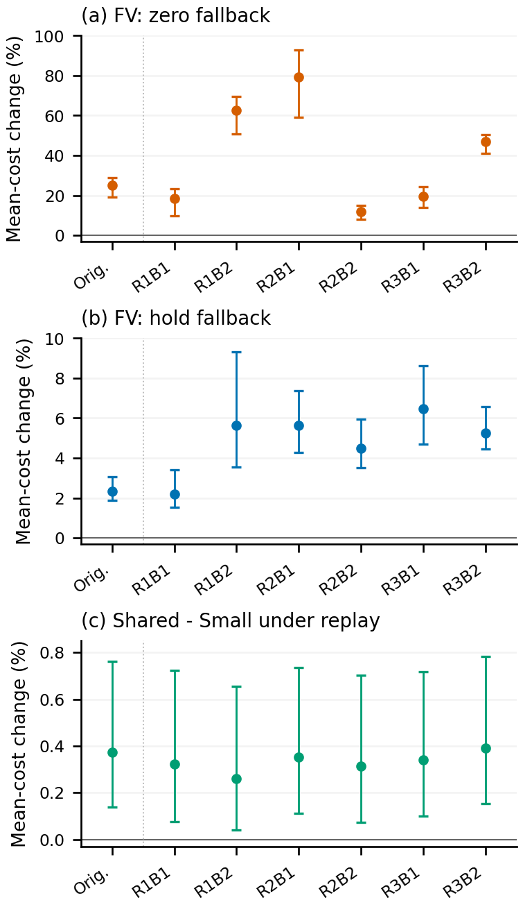
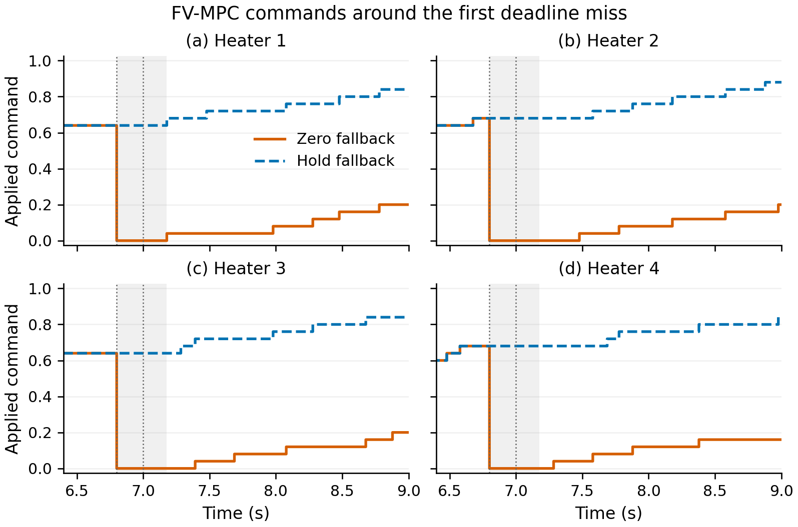

# Thermal Delay Evaluation

**Saved results and analysis linking inference delay, deadline handling, applied heater commands, and closed-loop performance.**

Companion to **Inference Delay and Deadline Handling in Thermal Controller Evaluation: A Retrospective Simulation Study**, by **Minsu Jo, Namhyun Yoo, Hoansuk Choi, and Jinhong Yang**. The English manuscript is in preparation for J-KICS. This **v1.1.0** package matches the manuscript revision prepared on **10 October 2026**.

[Quick start](#quick-start) · [Main findings](#main-findings) · [Table/figure map](supplement/TABLE_FIGURE_MAP.md) · [S1 guide](docs/Supplement_S1_guide.pdf) · [Reproduction scope](docs/REPRODUCTION.md) · [Citation](#citation)

## Main findings

The primary comparison uses **24 normal held-out episodes** and five fixed control systems: PI, finite-volume MPC (FV-MPC), physics-informed neural-operator MPC (PINO-MPC), Shared-Residual, and Small-Residual. Paired analyses reuse those episodes across conditions.

| Finding | Evidence | Scope |
|---|---|---|
| Deadline handling explains much of the observed FV-MPC cost increase. | Under the original replay, mean cost increases **25.02%** with zero fallback and **2.35%** with hold, relative to zero delay. Both retain eight deadline misses and eight skipped ticks per episode. | Matched timing and gate rules; the fallback command and subsequent feedback differ. |
| The effect persists across alternative replay settings. | Across six additional settings, increases are **11.70–79.34%** for zero and **2.19–6.46%** for hold. | Settings reuse three archived timing repeats. They are not six independent hardware measurements. |
| A ranking can change without deadline misses. | Shared has **0.275% lower** mean cost than Small at zero delay and **0.374% higher** cost under the original replay. | Small effects between complete fixed systems; process-level practical significance was not established. |
| Original aggregate comparisons survive the tested step refinement. | Original zero-delay and zero-fallback replay mean rankings persist at **10, 5, and 2.5 ms**. | Additional replay/hold conditions were tested at **10 ms only**. Individual trajectories remain sensitive. |

<p align="center">
  
</p>

The diagnostic procedure connects the latency consumed by each request to deadline handling, applied commands, and paired outcomes. It does not establish universal controller superiority, hardware safety, or a checkpoint selector's general benefit.

## What changed in v1.1.0

- Added **1,128 replay/fallback case records**: 240 original-condition reproductions, 720 additional-replay runs, and 168 FV hold runs, all on the same 24 normal episodes.
- Added the **57 paired contrasts**, replay-setting rankings, fixed protocol settings, and audit receipts.
- Added cost components, physical effect sizes, alpha-selection evidence, and the representative hold temperature curve.
- Added the first-deadline command diagnostic and clarified **N=600 nominal decision slots**, distinct from actual requests/application events.
- Added the complete map for **11 tables, six main figures, and two supplementary figures**, plus a three-page S1 guide.

The original v1.0.0 release and its two large raw-data assets remain unchanged. See [release notes](docs/RELEASE_NOTES.md).

## Quick start

Use Python **3.10+**, NumPy, and Matplotlib. The saved-result analysis runs on the CPU and requires no model weights or GPU. Version 1.1.0 was checked with Python 3.12.7, NumPy 1.26.4, and Matplotlib 3.9.2.

```bash
git clone https://github.com/JoMinsu-KU/thermal-delay-evaluation.git
cd thermal-delay-evaluation
git checkout v1.1.0
python -m pip install -r requirements.txt
python -B scripts/reproduce_all.py
```

The version tag becomes available when the maintainer publishes v1.1.0. Before then, use the prepared package directory directly and omit the clone/checkout commands.

The command checks both manifests and runs all current saved-result analyses. Outputs are written to **`supplement/outputs/`**. It does not execute a simulator, model inference, training, or fresh timing measurements.

### Find a particular result

Paths below are relative to `supplement/`.

| Manuscript item | Input | Script | Output |
|---|---|---|---|
| Tables 7–8: primary and residual comparisons | `data/primary/episode_metrics.csv` | `scripts/reproduce.py` | `outputs/table6_primary_costs.csv`, `table7_paired_comparisons.csv` |
| Table 9: replay/hold effects | `data/replay/episode_metrics.csv` | `scripts/reproduce_replay.py` | `outputs/replay_paired_results.json` (57 contrasts) |
| Figure 4: replay/hold summary | `data/replay/replay_results.json` | `scripts/make_replay_figure.py` | `outputs/figures/replay_fallback_sensitivity.*` |
| Table 10: physical effect sizes | `data/revision/cost_components.csv` | `scripts/reproduce_physical.py` | `outputs/physical_checks.json` |
| Table 11: step sensitivity | `data/numerical/extended_metrics.csv` | `scripts/reproduce.py` | `outputs/table8_numerical_sensitivity.csv` |
| Figure S2: first deadline miss | `data/minor_revision_r2/deadline_commands.csv` | `scripts/make_deadline_figure.py` | `outputs/figures/deadline_command_response.*` |

The [full table/figure map](supplement/TABLE_FIGURE_MAP.md) gives every input and generated result. Historical `table5`–`table8` filenames correspond to current Tables 6, 7, 8, and 11. Current figures are regenerated in PNG and PDF; [supplementary captions](supplement/SUPPLEMENTARY_FIGURES.md) explain S1 and S2.

For the first matched FV expiration at **6.8 s**, zero fallback changes `[0.64, 0.68, 0.64, 0.68]` to zeros while hold retains it. Figure S2 shows the resulting applied commands in the unchanged representative episode used for Figure 5.

<p align="center">
  
</p>

## Small standalone supplement

[Release v1.1.0](https://github.com/JoMinsu-KU/thermal-delay-evaluation/releases/tag/v1.1.0) is prepared with:

- `thermal-delay-supplement-v1.1.0.zip`: compact inputs, scripts, licenses, and the S1 guide;
- `Supplement_S1_guide.pdf`: three-page navigation guide with both supplementary figures;
- `SHA256SUMS`: checksums for these two assets.

After downloading and verifying the ZIP, extract it and run `python -B Supplement_S1/scripts/reproduce_review.py`. This produces the same analyses and eight figures as the repository entry point. Release download links become available after publication.

## Download and audit the detailed records

Original primary and numerical-validation event logs and temperature arrays remain available in [Release v1.0.0](https://github.com/JoMinsu-KU/thermal-delay-evaluation/releases/tag/v1.0.0).

| Release asset | Size | Contents |
|---|---:|---|
| [Primary experiment records](https://github.com/JoMinsu-KU/thermal-delay-evaluation/releases/download/v1.0.0/thermal-delay-primary-raw-v1.zip) | 113 MiB | Original D metrics/events, 180,000 latency request records, and original selected C traces |
| [Numerical validation records](https://github.com/JoMinsu-KU/thermal-delay-evaluation/releases/download/v1.0.0/thermal-delay-numerical-raw-v1.zip) | 263 MiB | All 741 validation runs, with quadrature for the 732-run extended batch and fixed-command C fields |
| [SHA256SUMS](https://github.com/JoMinsu-KU/thermal-delay-evaluation/releases/download/v1.0.0/SHA256SUMS) | <1 KiB | SHA256 checksums for the two ZIP files |

These are the unchanged v1.0.0 assets. They do not contain the later replay/hold batch. Both ZIPs expand into the Git-ignored `raw_data/` directory. Allow approximately **1 GiB** for the expanded records in addition to the ZIP files.

With [GitHub CLI](https://cli.github.com/):

```bash
gh release download v1.0.0 --repo JoMinsu-KU/thermal-delay-evaluation --pattern "thermal-delay-*-raw-v1.zip" --pattern "SHA256SUMS"
```

<details>
<summary>Linux/macOS: verify, extract, and audit</summary>

```bash
# Linux; on macOS use: shasum -a 256 -c SHA256SUMS
sha256sum -c SHA256SUMS
unzip thermal-delay-primary-raw-v1.zip
unzip thermal-delay-numerical-raw-v1.zip
python scripts/verify.py --raw-dir raw_data
python scripts/audit_raw.py --raw-dir raw_data
```

</details>

<details>
<summary>Windows PowerShell: verify, extract, and audit</summary>

```powershell
Get-Content -LiteralPath SHA256SUMS | ForEach-Object {
    $hash, $name = $_ -split '  ', 2
    if ((Get-FileHash -LiteralPath $name -Algorithm SHA256).Hash.ToLowerInvariant() -ne $hash) {
        throw "Checksum mismatch: $name"
    }
}
Expand-Archive -LiteralPath thermal-delay-primary-raw-v1.zip -DestinationPath .
Expand-Archive -LiteralPath thermal-delay-numerical-raw-v1.zip -DestinationPath .
python scripts/verify.py --raw-dir raw_data
python scripts/audit_raw.py --raw-dir raw_data
```

</details>

The raw audit writes to `outputs/raw_audit/`. It checks **732 independent quadrature cost reconstructions**, **243 baseline comparisons**, **12 fixed-field comparisons**, **720 D episode/step trace comparisons**, **180,000 journal row hashes**, and **71,808 replay-request mappings**. For the earlier nine C runs, tracking quadrature was not saved; their cost checks use reported tracking RMSE with independently reconstructed command terms and final fields.

Here, “independent reconstruction” describes recalculation from the saved records. It does not mean independently sampled runs or a new experiment.

## Experimental units and limits

| Evidence group | Coverage | Unit / boundary |
|---|---|---|
| A/B development | Checkpoint and validation records | Reused development episodes; no independent selector-benefit claim |
| C diagnostic | One selected episode; three original conditions, nine refinements, 12 fixed-command runs | Earlier direct scorer; not the D controller version |
| D original archive | 480 records: five methods × two modes × 48 episodes | Main sample: 24 normal test episodes; eight initially hot and 16 OOD episodes are separate |
| D step refinement | 720 runs at 10/5/2.5 ms | Same 24 normal episodes |
| Replay/fallback batch | 1,128 runs | Same 24 normal episodes; additional settings use a 10-ms cap |
| Latency measurements | 180,000 original requests, three process repeats | Reused archived inputs/timing sequences |

Bootstrap intervals condition on the selected models and fixed replay sequences, using **20,000 paired episode resamples**, seed **20261007**. Percentage changes in mean cost are ratios of means. Repeated conditions do not enlarge the independent episode sample.

The compact supplement supports **saved-result reanalysis**. It omits model weights, full training/cache inputs, raw timing journals, complete quadrature arrays, and full fields. Original primary/numerical raw reconstruction is available through the unchanged v1.0.0 assets. **Full raw records for the later replay/hold batch are not part of this public update**; its published compact records and audit receipts cannot independently repeat the full raw-input audit or generate new closed-loop conditions.

## Repository layout

```text
supplement/             Current manuscript inputs, methods, scripts, and S1 guide
  data/replay/          All 1,128 compact case results and 57 contrasts
  data/revision/        Cost components and physical/temperature inputs
  data/minor_revision/ Alpha validation and representative hold temperature
  data/minor_revision_r2/ Applied zero/hold command records and provenance
  TABLE_FIGURE_MAP.md   Current table and figure mapping
scripts/reproduce_all.py Current manuscript reproduction entry point
data/                   Preserved original evidence and release metadata
scripts/                Original analysis and raw-audit tools retained
figures/                Current six main and two supplementary figures
experiment_source/      Original source and replay/fallback implementation excerpts
docs/                   Guide, reproduction scope, provenance, and release notes
MANIFEST.sha256         Public repository file checksums
```

The original `scripts/reproduce.py` remains available for the v1.0.0 analysis; it writes to root `outputs/` and retains historical figure/table numbering. Use **`scripts/reproduce_all.py` for the current manuscript**.

## Citation

Please cite the data release and record the version used. [CITATION.cff](CITATION.cff) supplies the GitHub citation metadata. No manuscript DOI or acceptance status is asserted.

```bibtex
@misc{jo2026thermaldelaydata,
  author = {Jo, Minsu and Yoo, Namhyun and Choi, Hoansuk and Yang, Jinhong},
  title = {Data and Analysis for Inference Delay and Deadline Handling in
           Thermal Controller Evaluation: A Retrospective Simulation Study},
  year = {2026},
  version = {1.1.0},
  url = {https://github.com/JoMinsu-KU/thermal-delay-evaluation/releases/tag/v1.1.0},
  note = {Research data and analysis code; manuscript in preparation}
}
```

## License

- **Code and documentation:** [MIT](LICENSE).
- **Data and research figures:** [CC BY 4.0](DATA_LICENSE), with the [legal text](LICENSES/CC-BY-4.0.txt) included. Attribute the authors/version and indicate changes.

External dependencies retain their own terms. Model weights, literature PDFs, journal templates/fonts, manuscript source, and internal review correspondence are not included. Report reproducibility issues through [GitHub Issues](https://github.com/JoMinsu-KU/thermal-delay-evaluation/issues) with the version, command, and relevant output.
